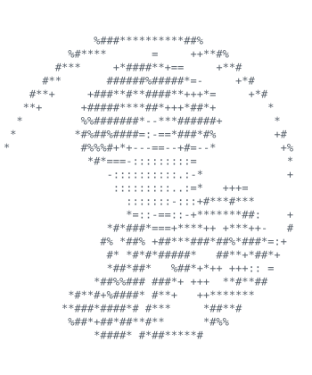
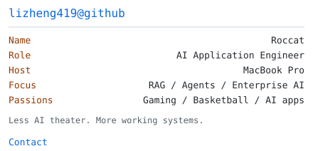
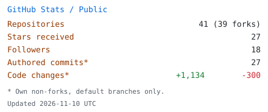

<table>
<tr>
<td width="38%" valign="middle">
<picture>
<source media="(prefers-color-scheme: dark)" srcset="img/profile-avatar-dark.svg"/>
<source media="(prefers-color-scheme: light)" srcset="img/profile-avatar-light.svg"/>

</picture>
</td>
<td width="62%" valign="top">
<picture>
<source media="(prefers-color-scheme: dark)" srcset="img/profile-info-dark.svg"/>
<source media="(prefers-color-scheme: light)" srcset="img/profile-info-light.svg"/>

</picture>

<samp>&#160;&#160;GitHub: <a href="https://github.com/lizheng419">@lizheng419</a> 
&#160;&#160;X:&#160;&#160;&#160;&#160;&#160;&#160;<a href="https://x.com/Roccat_fi">@Roccat_fi</a></samp>

<picture>
<source media="(prefers-color-scheme: dark)" srcset="img/profile-stats-dark.svg"/>
<source media="(prefers-color-scheme: light)" srcset="img/profile-stats-light.svg"/>

</picture>
</td>
</tr>
</table>
